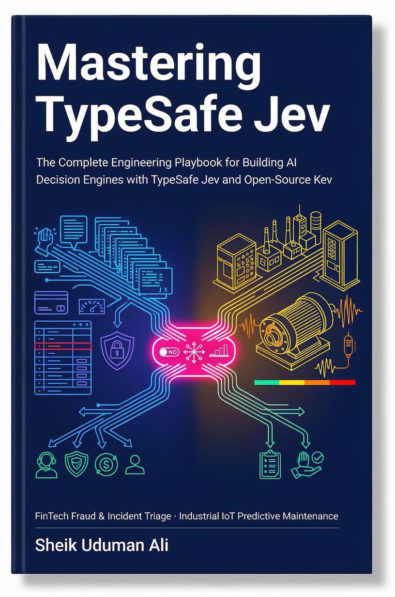
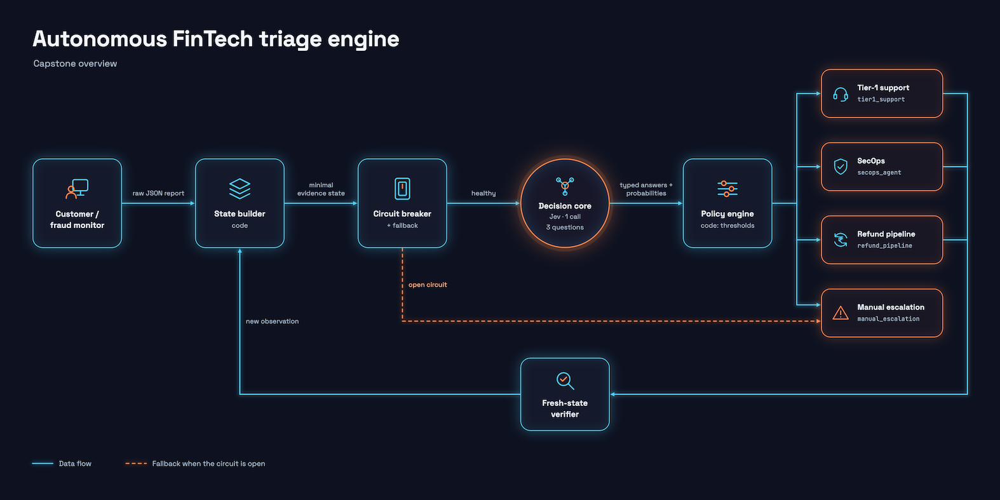
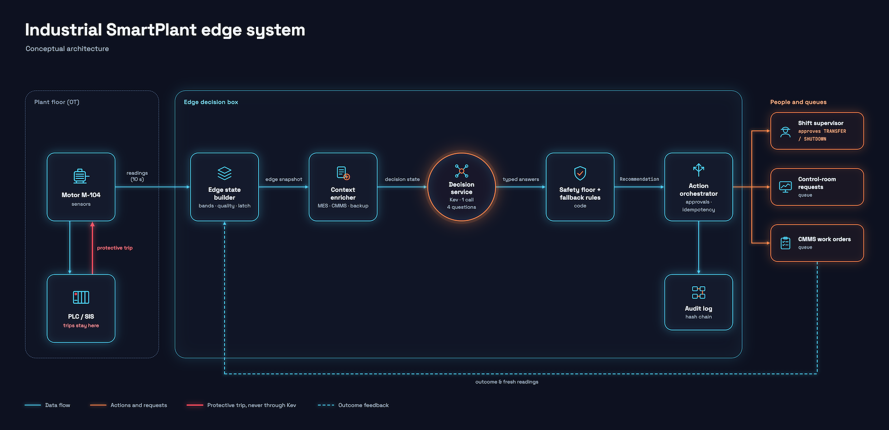
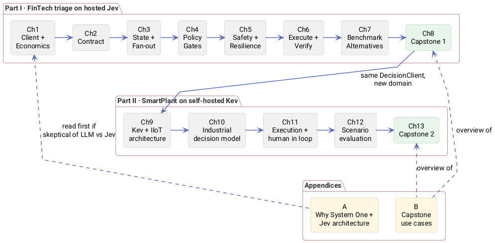
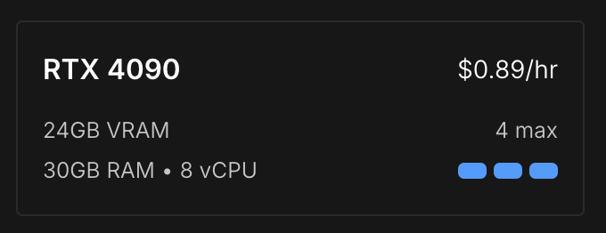
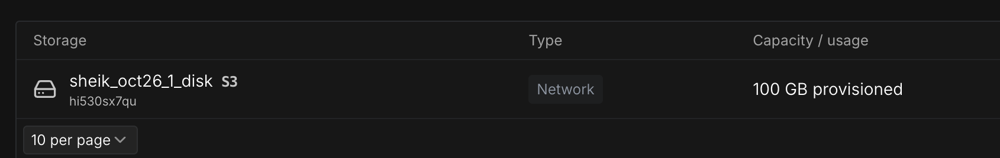
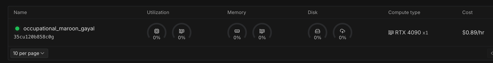

# Mastering TypeSafe Jev

Companion Source Code repository for [Mastering TypeSafe Jev](https://mastering-jev-and-kev-book.vercel.app/) book.



**The Complete Engineering Playbook for Building AI Decision Engines with TypeSafe Jev and open-source Kev**

> Code computes. LLMs create. Jev decides. Fresh state proves the result.

This is a short, hands-on book about one idea: moving the small judgments inside your software (route this, flag that, is this safe, what should operations do next) out of brittle `if` statements and slow LLM prompts, and into a fast, typed **System One** decision model.

It isn't a survey. Every chapter ships working Python, a mini-project, and one more layer of a production-shaped system. The book builds **two capstones on one shared decision client**:

| | Part I | Part II |
|---|---|---|
| Capstone | **Autonomous Incident & FinTech Triage Engine** | **SmartPlant Decision Intelligence** (Industrial IoT) |
| Decision model | TypeSafe **Jev** (hosted API) | **Kev** ([jaredpalmer/kev](https://github.com/jaredpalmer/kev), self-hosted, open source) |
| Chapters | 1–8 | 9–13 |
| Package | `triage` (`capstone-project/`) | `smartplant` (`smartplant-capstone/`), reuses `triage` |

Two appendices explain **why** a System One model beats a regular LLM for decisions (and how Jev works inside), and summarise **both capstones' use cases** for readers who won't read the code.

**At a glance:** 13 chapters + 2 appendices · 60 PlantUML diagrams (source + PNG) · 2 installable packages · 48 automated tests (+1 live eval) · 12 runnable mini-projects across both parts, with 10-minute hands-on walk-throughs in Chapters 10–13.

---

## The two capstones

### Capstone 1: Autonomous Incident & FinTech Triage Engine (Part I)

| Input | Jev decisions (one call) | Code decides |
|---|---|---|
| Support / fraud report payload (JSON) | `is_fraud_suspected` (Noul) · `urgency_rating` 1–5 (Score) · `dispatch_target` (Choice: `tier1_support`, `secops_agent`, `refund_pipeline`, `manual_escalation`) | Eligibility, fraud override, per-target confidence gates, refund approval limits, circuit breaker + fallback, fresh-state verification, decision trace |



### Capstone 2: SmartPlant Decision Intelligence (Part II)

| Input | Kev decisions (one call) | Code decides |
|---|---|---|
| Motor telemetry (vibration, bearing temperature, current, RPM) + MES / CMMS / backup context | `intervention_urgency` (Choice) · `operational_action` (Choice: `MONITOR`, `INSPECT`, `SCHEDULE_MAINTENANCE`, `TRANSFER_LOAD`, `REQUEST_SHUTDOWN`) · `standard_workflow` (Noul) · `operational_severity` 1–5 (Score) | Safety partition (PLC trips stay authoritative), data-quality gate, eligibility, safety floor, operator approvals, idempotent work orders, fallback rules, hash-chained audit, fine-tuning export |



[Appendix B](chapters/appendix-b-capstone-use-cases.md) has the actors, use cases, conceptual models and end-to-end journeys for both.

---

## Contents



### Part I: FinTech triage on cloud hosted Jev

| # | Chapter | You build | Capstone increment |
|---|---|---|---|
| 1 | [Foundations: System One AI & Decision Economics](chapters/01-foundations.md) | Multi-client starter + latency harness | `jev_client.py`: swappable decision client |
| 2 | [The Three Primitives & Decision Contracts](chapters/02-question-primitives.md) | Support ticket evaluator | `contract.py`: the triage contract |
| 3 | [State Engineering & Speculative Fan-Out](chapters/03-state-and-parallelism.md) | Lead / inbox qualification engine | `state_builder.py`: evidence state from raw payloads |
| 4 | [Confidence-Gated Architecture & Routing](chapters/04-confidence-and-routing.md) | Chief-of-Staff task router | `policy_engine.py` + `trace.py`: bands, gates, decision trace |
| 5 | [Failure Modes, Limits & Safety Verification](chapters/05-limits-and-verification.md) | Semantic linter & safety gate | `resilience.py` + labeled evals |
| 6 | [Agentic Control Layers & Integrations](chapters/06-agentic-harnesses.md) | BM25 + Jev re-ranker | `executors.py` + `verifier.py` + `tool_guard.py`: the closed loop |
| 7 | [Alternatives & Benchmarks](chapters/07-alternatives-and-benchmarks.md) | Benchmark harness: Jev vs Kev vs OpenAI Decisions | `cascade.py` + engine decision record |
| 8 | [Capstone: The Triage Engine, End to End](chapters/08-capstone.md) | Full service, tests, rollout plan | `engine.py`, `wiring.py`, `service.py` |

### Part II: SmartPlant on self-hosted Kev

Same `DecisionClient`, same circuit breaker, a new domain, and a decision model you host yourself.

| # | Chapter | Mini-project | SmartPlant increment |
|---|---|---|---|
| 9 | [Open-Source Kev & Industrial IoT Architecture](chapters/09-kev-and-iiot-architecture.md) | `08-iot-sensor-simulator` | `KevDecisionClient`, simulator, fault injection, edge snapshots |
| 10 | [Industrial Decision Modeling with Kev Primitives](chapters/10-industrial-decision-modeling.md) | `09-smartplant-decision-service` | Contract, MES/CMMS enrichment, decision service, safety floor |
| 11 | [Execution, Human-in-the-Loop & Safety Boundaries](chapters/11-execution-hitl-safety.md) | `10-closed-loop-controller` | Approvals, idempotent work orders, audit chain, fallbacks |
| 12 | [Scenario Evaluation & Benchmark Suite](chapters/12-scenario-evaluation.md) | `11-smartplant-eval-suite` | Rules vs LLM vs Kev on 10 scenarios, metrics, dashboard |
| 13 | [Capstone: SmartPlant End to End](chapters/13-smartplant-capstone.md) | — | Edge deployment, security zones, governance, fine-tuning Kev from the audit trail |

### Appendices

| | Appendix | What you get |
|---|---|---|
| A | [Why Jev or Kev Instead of a Regular LLM, and How Decision Engines Work Inside](chapters/appendix-a-why-system-one.md) | LLM vs decision-engine matrix; OpenDecision, Jev and Kev architectures, each labelled published / contract / inferred; side-by-side comparison; where the engine sits in SmartPlant; an engine evaluation plan; what each trait means for your code; `triage.probes` to test order sensitivity, question isolation, option interaction and fan-out latency on **your** backend |
| B | [The Two Capstones: Use Cases at a Glance](chapters/appendix-b-capstone-use-cases.md) | Side-by-side comparison; problem, actors, use-case diagrams, conceptual models, end-to-end journeys and success measures for both capstones; the shared six-step pattern; a checklist for choosing your own use case |

### Suggested reading paths

| You are… | Read |
|---|---|
| New to System One models | Appendix A §A.1–A.2 → Ch 1–4 → Appendix B |
| Building a hosted-API decision service | Part I in order (Ch 1–8) |
| Working in manufacturing / OT, or data must stay on-site | Ch 1–2 (client + primitives) → Part II (Ch 9–13) |
| Architect or reviewer | Appendix B → Ch 8 → Ch 13 → Appendix A §A.3–A.10 |
| Choosing between Jev, Kev, OpenDecision, an LLM or rules | Appendix A → Ch 7 → Ch 12 |

---

## Machine

Part I (Chapter 1 to 8) does not require GPU machines.  You can run on a standard computer.

Part II needs GPU machine for Kev.

You can buy Cloud GPU machine from https://www.runpod.io/.  You can use RTX 4090 Pod with 100GB Network storage disk. 





## Setup

The repo is a **uv workspace**. Both capstones, `capstone-project/src/triage` (Part I) and `smartplant-capstone/src/smartplant` (Part II), are installed as editable packages into one shared `.venv`, so every mini-project just writes:

```python
from triage.jev_client import client_from_env          # no sys.path.append(...) anywhere
from smartplant.decision_service import SmartPlantDecisionService
```

```bash
# 1. Install uv (once)
curl -LsSf https://astral.sh/uv/install.sh | sh          # macOS / Linux
# powershell -c "irm https://astral.sh/uv/install.ps1 | iex"   # Windows

# 2. From the repo root: one venv, triage + smartplant installed editable
uv python install 3.12                                   # SDK needs Python 3.10+
uv sync                                                  # creates .venv + uv.lock (dev group included)
uv sync --group adapter --group ch7                      # add groups per chapter as you need them

# 3. Configure the decision backend (Part I: hosted Jev)
export TYPESAFE_API_KEY=your_key                         # never commit this
export JEV_MODEL=jev-1.13.0                              # pin the version you calibrate against

# 4. Run things (from the root or from inside any mini-project folder)
uv run pytest -q                                         # 48 passed, 1 skipped (Part I live eval)
uv run pytest -q capstone-project                        # Part I only: 17 passed, 1 skipped
uv run pytest -q smartplant-capstone                     # Part II only: 26 passed
RUN_LIVE_EVALS=1 uv run pytest capstone-project/tests/test_labeled_evals.py -s   # replay labeled set against Jev
uv run python -m triage.probes                           # Appendix A: probe your backend's behaviour
uv run python mini-projects/07-multi-engine-benchmark/multi_engine_eval.py --engines offline   # Ch7; add jev,kev,openai-decisions
```

**Part II: run Kev locally.** Kev needs Python 3.12/3.13 and torch, so clone it **outside** this workspace and give it its own venv:

```bash
git clone https://github.com/jaredpalmer/kev.git ~/src/kev && cd ~/src/kev
uv sync --extra serve
uv run --extra serve python -m kev.serve --run jaredpalmer/kev-0.8b --port 8009   # kev-4b for accuracy work

# back in this repo
export DECISION_BACKEND=kev KEV_BASE_URL=http://127.0.0.1:8009   # + KEV_API_KEY if the server sets one
uv run python mini-projects/08-iot-sensor-simulator/run_simulator.py --fault gradual_degradation
uv run python mini-projects/08-iot-sensor-simulator/kev_console.py snapshots.jsonl            # Kev's decision per snapshot
uv run python mini-projects/09-smartplant-decision-service/run_decision_service.py S06 S07
uv run python mini-projects/10-closed-loop-controller/run_controller.py --kev-down-at 120
uv run python mini-projects/11-smartplant-eval-suite/run_eval.py --kev      # add --llm for the 3-way benchmark
DECISION_BACKEND=kev uv run python -m triage.probes                         # Appendix A probes against Kev
# no Kev box yet? add --offline (mini-projects 09/10) or drop --kev (11) to use the scripted stand-in
```

| Variable | Used by | Purpose |
|---|---|---|
| `DECISION_BACKEND` | `client_from_env()` | `jev` (default), `kev` or `adapter` |
| `TYPESAFE_API_KEY`, `JEV_MODEL` | Jev backend | Hosted API key; pinned model version |
| `KEV_BASE_URL`, `KEV_MODEL`, `KEV_API_KEY` | Kev backend | Local server (default `http://127.0.0.1:8009`), model alias, optional key |
| `ADAPTER_PROVIDER`, `ADAPTER_MODEL` | Adapter backend | Build before you have Jev access; LLM baselines |
| `OPENAI_API_KEY`, `OPENAI_DECISIONS_MODEL`, `OPENAI_BASE_URL` | Ch7 `OpenAIDecisionsClient` | OpenAI Decisions API (default model `gpt-6-luna`); base URL only for a gateway |
| `RUN_LIVE_EVALS` | Part I eval test | Replay the labeled set against a real backend |

Edits to `capstone-project/src/triage/*.py` or `smartplant-capstone/src/smartplant/*.py` show up everywhere immediately, with no reinstall. Commit `uv.lock` so everyone resolves the same SDK version. Pinning the SDK matters for the same reason as pinning `JEV_MODEL` or the Kev checkpoint.

## Repository layout

```text
mastering-jev-guide/
├── pyproject.toml                # uv workspace root: depends on triage-engine + smartplant (editable)
├── uv.lock                       # commit this
├── .venv/                        # one shared environment (git-ignored)
├── README.md
├── capstone-project/             # workspace member -> installable package "triage-engine"
│   ├── pyproject.toml            # hatchling build, packages = ["src/triage"]
│   ├── src/triage/
│   │   ├── jev_client.py         # Ch1 (+ KevDecisionClient, Ch9)
│   │   ├── contract.py           # Ch2
│   │   ├── state_builder.py      # Ch3
│   │   ├── policy_engine.py      # Ch4
│   │   ├── trace.py              # Ch4
│   │   ├── resilience.py         # Ch5
│   │   ├── executors.py          # Ch6
│   │   ├── verifier.py           # Ch6
│   │   ├── tool_guard.py         # Ch6
│   │   ├── cascade.py            # Ch7
│   │   ├── engine.py, wiring.py, fakes.py, service.py   # Ch8
│   │   └── probes.py             # Appendix A (python -m triage.probes)
│   ├── tests/                    # labeled_cases.jsonl + 6 test modules (17 tests + 1 live)
│   └── tools/sweep_threshold.py  # Ch4
├── smartplant-capstone/          # workspace member -> installable package "smartplant"
│   ├── pyproject.toml            # depends on triage-engine; console scripts smartplant-sim/-eval/-export
│   ├── src/smartplant/
│   │   ├── sensor_simulator.py  fault_injector.py  edge_state_builder.py       # Ch9
│   │   ├── contract.py  context_enricher.py  models.py  decision_service.py    # Ch10
│   │   ├── fallback_rules.py  cmms_mock_service.py  audit_log.py               # Ch11
│   │   ├── action_orchestrator.py                                              # Ch11
│   │   ├── scenario_runner.py  benchmark_metrics.py  eval_dashboard.py         # Ch12
│   │   ├── training_export.py                                                  # Ch13
│   │   └── data/test_scenarios.json  # packaged, so mini-projects 09 and 11 share it with no paths
│   └── tests/                    # 26 tests; Kev integration tested against a mock server
└── mini-projects/
    ├── 01-starter-client/ … 07-multi-engine-benchmark/   # Part I: code is in Ch1–7; create as you follow along
    ├── 08-iot-sensor-simulator/run_simulator.py  kev_console.py   # kev_console: replay snapshots through Kev
    ├── 09-smartplant-decision-service/run_decision_service.py
    ├── 10-closed-loop-controller/run_controller.py
    └── 11-smartplant-eval-suite/run_eval.py
    └── 12-learning-loop/record_outcomes.py                    # Ch13: technician outcomes -> training data
```

Part I's mini-projects (01–07) are listed in full inside their chapters, which tell you which file each listing belongs in. Part II's mini-projects ship as runnable entry points. Their "key files" (`sensor_simulator.py`, `fallback_rules.py`, `scenario_runner.py`, …) live in the `smartplant` package, because later mini-projects import earlier ones.

Two rules keep imports clean:

- **Shared code** lives in a package (`triage`, `smartplant`) and is imported as `from triage... import ...`.
- **Mini-project-local modules** (e.g. `triage_schema.py`, `queue_manager.py`) are imported by plain name. Python puts the running script's folder on `sys.path`, so `uv run python mini-projects/02-support-triage/evaluator.py` finds `triage_schema` without any configuration. Give them names that don't collide with `triage`, `smartplant` or the standard library.

### `pyproject.toml` (root)

```toml
[project]
name = "mastering-jev-guide"
version = "1.0.0"
description = "Mastering Jev: book workspace (chapters, mini-projects, two capstones)"
requires-python = ">=3.10"
dependencies = [
    "triage-engine",                      # Part I:  `import triage` everywhere
    "smartplant",                         # Part II: `import smartplant` everywhere
]

[dependency-groups]
dev = ["pytest>=8"]
adapter = ["system-one-adapter[openai]"]          # Ch1: build before you have a Jev key
ch3 = []                                          # uses typesafe-sdk async client only
ch6 = []                                          # pure-Python BM25
ch7 = ["openai>=3.26", "matplotlib", "scikit-learn"]  # Decisions API client, plot, classical baseline
service = ["fastapi", "uvicorn"]                  # Ch8 HTTP entry point
iot = ["paho-mqtt>=2"]                            # Part II: optional MQTT publish/subscribe

[tool.uv]
package = false                                   # the root is a workspace, not a library
default-groups = ["dev"]

[tool.uv.workspace]
members = ["capstone-project", "smartplant-capstone"]

[tool.uv.sources]
triage-engine = { workspace = true }              # editable install of capstone-project/src/triage
smartplant = { workspace = true }                 # editable install of smartplant-capstone/src/smartplant
```

### `capstone-project/pyproject.toml`

```toml
[project]
name = "triage-engine"
version = "1.0.0"
description = "Autonomous Incident & FinTech Triage Engine (Mastering Jev capstone)"
requires-python = ">=3.10"
dependencies = ["typesafe-sdk"]

[build-system]
requires = ["hatchling"]
build-backend = "hatchling.build"

[tool.hatch.build.targets.wheel]
packages = ["src/triage"]

[tool.pytest.ini_options]
testpaths = ["tests"]
```

### `smartplant-capstone/pyproject.toml`

```toml
[project]
name = "smartplant"
version = "1.0.0"
description = "SmartPlant Industrial IoT decision intelligence on open-source Kev (Mastering Jev, Part II capstone)"
requires-python = ">=3.10"
dependencies = ["triage-engine"]       # reuses triage.jev_client + triage.resilience

[project.scripts]
smartplant-sim = "smartplant.sensor_simulator:main"
smartplant-eval = "smartplant.scenario_runner:main"
smartplant-export = "smartplant.training_export:main"

[build-system]
requires = ["hatchling"]
build-backend = "hatchling.build"

[tool.hatch.build.targets.wheel]
packages = ["src/smartplant"]

[tool.uv.sources]
triage-engine = { workspace = true }

[tool.pytest.ini_options]
testpaths = ["tests"]
```

> Why a workspace and not `sys.path` tricks or a `src/` copy per project? The packages are installed once, in editable mode, from a single lock file. IDEs (VS Code, PyCharm) resolve `triage` and `smartplant` through the selected `.venv` interpreter, so autocomplete and type checking work in every mini-project too.

## Sources and a note on numbers

Prices, latencies and benchmark figures come from:

- TypeSafe's published material and docs
- Flavio Copes, *A Deep Dive into Jev* (Sep 2026)
- @0xCodila, *Jev Engineering* playbook (Sep 2026)
- the jaredpalmer/kev README (Oct 2026, Part II)
- OpenAI Decisions API beta docs and independent write-ups (Oct 2026, Chapter 7), listed at the end of that chapter
- Archer Hume, *Jev's Architecture Unmasked* (17 Sep 2026, Appendix A), a black-box study whose architectural claims are inferences, labelled as such
- the deepanwadhwa/OpenDecision README and the *Decision Systems Architecture: OpenDecision, Jev, Kev* brief (Appendix A)

Vendors report their best cases, and Kev is a young, fast-moving project, so check its README before relying on model names or flags. The OpenAI Decisions API is in public beta, so re-check its schema and prices at GA. Every chapter includes a harness so you can measure on your own traffic, and your own measurements are the only numbers to put in a design doc.
